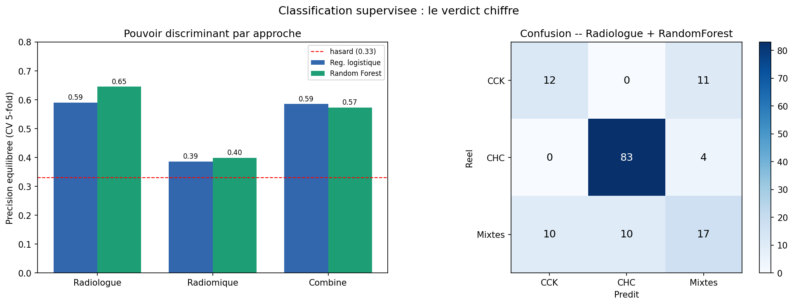
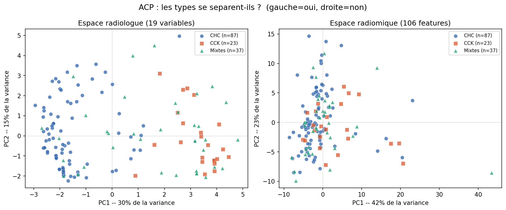
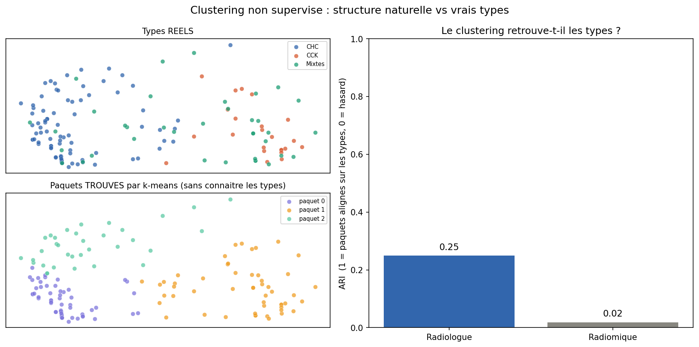
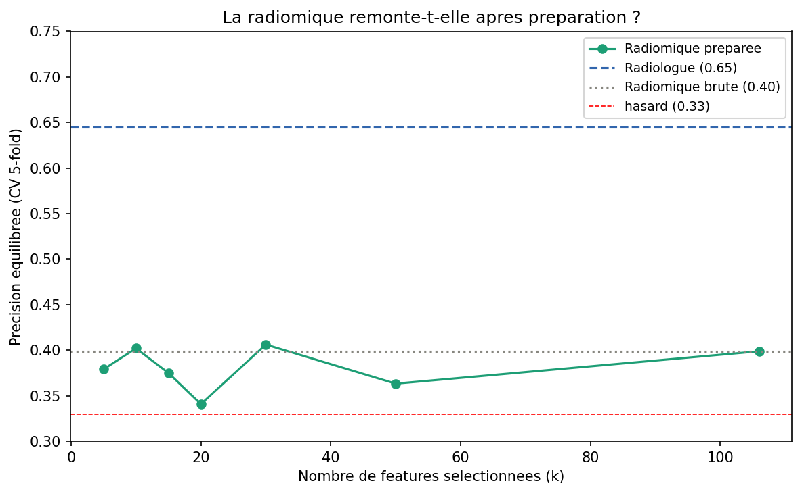

# Liver MRI radiomics vs radiologist

Can 106 PyRadiomics features tell apart three liver tumour types (HCC, cholangiocarcinoma, mixed)
on MRI as well as a radiologist's qualitative reading? **No:** on 147 patients the radiologist's
19 variables reach a balanced accuracy of **0.69**, radiomics **0.39** — barely above chance
(0.33) — and adding radiomics to the radiologist's reading makes it worse (0.59).

**My contribution:** Team project. My part: the whole analysis pipeline — data merging, PCA,
clustering, supervised classification and repeated cross-validation.



## Approach

- **Data.** 147 patients (87 HCC, 37 mixed, 23 cholangiocarcinoma). Two sources are merged on
  the composite key `(class, patient_num)`, because `patient_num` is reused across classes:
  a radiologist's reading (19 qualitative variables) and PyRadiomics features from the 3D
  volume resampled to 2 mm (`original_*` columns only; `diagnostics_*` metadata dropped).
- **One row per patient.** Each patient has one radiomics row per injection phase
  (arterial / portal / late); the phases are averaged.
- **Three angles, same pipeline** (median imputation → z-score → model): PCA, k-means with
  k = 3 scored by adjusted Rand index, then supervised classification (logistic regression and
  random forest, `class_weight="balanced"`) in stratified 5-fold cross-validation.
- **A second chance for radiomics.** Univariate feature selection (`SelectKBest`, k from 5
  to 106) placed *inside* the cross-validation pipeline, so the test fold never influences
  which features are kept.

## Results

Balanced accuracy — the right metric with 87 / 37 / 23 classes — in stratified 5-fold
cross-validation, repeated over 20 shuffles (`repeated_cv.py`):

| Features | Random forest | Logistic regression |
|---|---|---|
| Radiologist (19 variables) | **0.691** ± 0.028 (0.62–0.73) | 0.641 ± 0.027 |
| Radiomics (106 features) | 0.386 ± 0.021 (0.35–0.42) | 0.396 ± 0.032 |
| Both combined | 0.585 ± 0.022 | 0.588 ± 0.025 |
| Chance | 0.333 | 0.333 |

Mean ± standard deviation across the 20 shuffles, min–max in brackets. Over every one of the
20 splits the radiologist's worst score stays above radiomics' best: the gap does not
depend on how the patients are split.

The other analyses point the same way (`main.py`, single split `random_state=0`):

- **Unsupervised.** k-means recovers the tumour types from the radiologist's variables
  (ARI 0.249) but not from radiomics (ARI 0.019, i.e. no structure aligned with the classes).




- **Where the radiologist fails.** HCC is recognised almost perfectly (83 / 87), but mixed
  tumours are spread across all three classes (17 / 37 correct) and half of the
  cholangiocarcinomas are called mixed (11 / 23). Mixed tumours combine features of the other
  two by definition, so this is where any method should struggle.
- **Feature selection does not rescue radiomics.** Keeping the top 5 to 106 features leaves
  balanced accuracy between 0.34 and 0.41, never meaningfully above the 0.40 of all features.



## Limitations

- **Small sample, and unequal classes.** 147 patients, 23 in the smallest class: each
  cholangiocarcinoma in a test fold moves the score. Repeated CV bounds this variance, but
  the absolute numbers would move on another hospital's data.
- **Averaging the injection phases throws away the signal radiologists use.** A radiologist
  reads how the tumour's enhancement *changes* between arterial, portal and late phases;
  averaging them erases exactly that. Per-phase features, or their differences, are the
  obvious next experiment.
- **Intensities have no absolute unit on MRI.** First-order and texture features depend on
  scanner and acquisition settings; z-scoring across patients does not correct that. No
  intensity harmonisation (e.g. ComBat) was applied.
- **The radiologist reference is one reader.** No inter-reader agreement is available, so the
  0.69 is one radiologist's performance, not the radiologist's.
- **Choosing the best k for feature selection on the same CV is slightly optimistic.** It
  does not change the conclusion here, since even the best k stays at chance level.
- **The patient data cannot be published.** The repository contains code and results only — no
  MRI image and no per-patient table. The PCA and clustering plots show one anonymous point per
  patient, with no identifier.

## Reproduce

The data are confidential patient records and are not distributed. With access to the two
spreadsheets (`Relectures_imageries.xlsx`, `global_excel_resampled.xlsx`) placed at the repository
root:

```bash
python -m venv venv && source venv/bin/activate
pip install -r requirements.txt

python main.py              # data check, PCA, k-means, classification (single split)
python repeated_cv.py       # results table above, 20 shuffles
python radiomique_preparee.py   # feature-selection sweep + figure

python graphe_acp.py              # figures, written to the working directory
python graphe_clustering.py
python graphe_classification.py
```

Tested with Python 3.9, scikit-learn 1.6.1, pandas 2.3.3.
